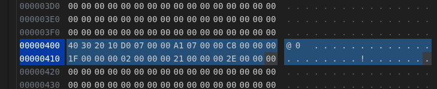
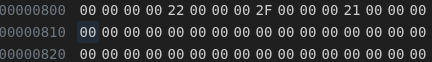
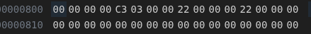

## Research notes for the vsfs

### 2026-11-11

**Note 1**:

I noticed that `fs.img` places the superblock at 0x400:



Eventually I realized that one block is not 512 bytes, as described in the xv6 book, but 1024 bytes.

```C
// fs.h

#define BSIZE   1024 // block size
```

**Note 2**:

I'm working on an "intepreter" for the vsfs in Python. I'll need to understand the format to break down `fs.img` into components. Where is the superblock and how to intepret it? Where are the inodes and can I connect them to the data blocks? Etc.

Here is the suprtblock struct. I have already identified the starting address at 0x400 so it should be too difficult:

```C
// Disk layout:
// [ boot block | super block | log | inode blocks | free bit map | data blocks]
//
// mkfs computes the super block and builds an initial file system. The
// super block describes the disk layout:
struct superblock {
  uint magic;      // Must be FSMAGIC
  uint size;       // Size of file system image (blocks)
  uint nblocks;    // Number of data blocks
  uint ninodes;    // Number of inodes.
  uint nlog;       // Number of log blocks
  uint logstart;   // Block number of first log block
  uint inodestart; // Block number of first inode block
  uint bmapstart;  // Block number of first free map block
};
```

Each `unit` is 4-byte, so it is pretty trivial to map it to a Python object.

For the logs that follow the superblock, the structures are:

```C
// log.c

struct logheader {
  int n;
  int block[LOGBLOCKS];
};

struct log {
  struct spinlock lock;
  int start;
  int outstanding; // how many FS sys calls are executing.
  int committing;  // in commit(), please wait.
  int dev;
  int ncommit;
  struct logheader lh;
};
struct log log;
```

However I don't know how many `struct log` do we have. I need to read the source code.


**Note 3**:

The number of log blocks is defined in the superblock. In `mkfs.c` we can find the following code:

```C
// LOGBLOCKS = 30 in vsfs
int nlog = LOGBLOCKS + 1; // Header followed by LOGBLOCKS data blocks.
```

Starting from 0x0800, we have potentially 31 blocks of logs -- one header block and 30 log blocks. I'm trying to figure out the exact content of those blocks with experiments.

Experiment 1:

In GDB, `b log_write()`, then `c`. In xv6, `echo "Hello world!" > log_test.txt`. This should trigger the breakpoint at `log_write()`. In VSCode, I opened up `fs.img` and started to inspect the data at 0x800.



Unfortunately I lost the trace somehow. But I pressed `c` until the write was done and I was back in the console, and immediately inspected the content of `fs.img`. First, by searching for "Hello" in the Hex editor, I found the block at 0xF0C00 contained the string `"Hello world!"`. The same content appeared at 0xC00, which is the first log block. I then inspected the log header block:



I didn't know why the first 4-byte was 0 -- this represented the `int n` part of the logheader struct. But the next 4-byte showed 0x03C3. Now 0xF0C00 / 0x400 = 0x03C3, so this was indeed the block number. Two 0x22 followed.

Q1: Why are there two 0x22?

A: Since my activity created a new file, this likely touched many FS blocks -- inode block, bitmap block, data blocks, etc. Why two, not more? I need to read the source code to see if xv6 batches commits.

Q2: 0x22 * 0x400 = 0x8800, but I have no idea what's the data there?

A: This is actually the inode block, which lives at exactly 0x8800, after the log blocks.

Q3: I only submitted one write (for the txt file), why there are 3 log blocks?

A: See the answer for Q1.

Q4: Actually, 0x22 was there in the beginning state of the log header block, but I didn't see any `log_write()` call during initalization.


**Note 4**:

